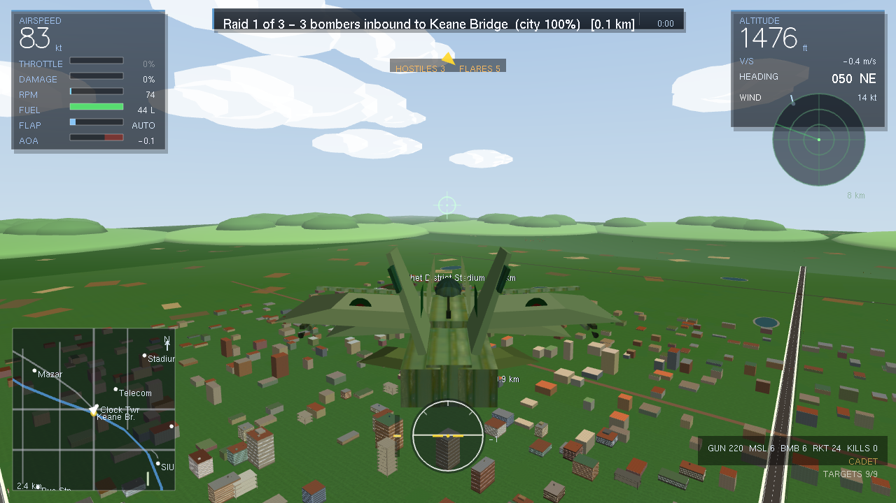
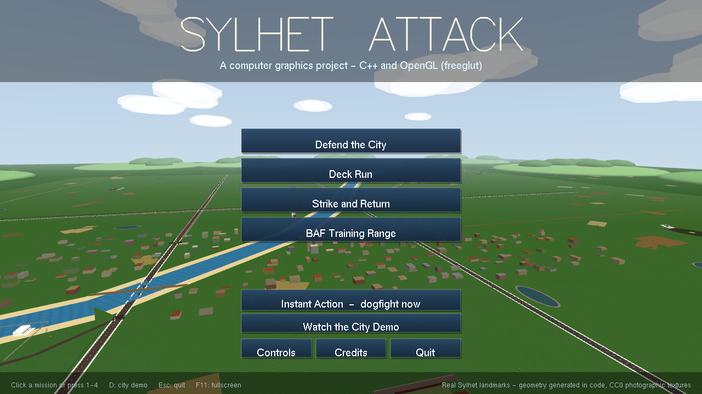
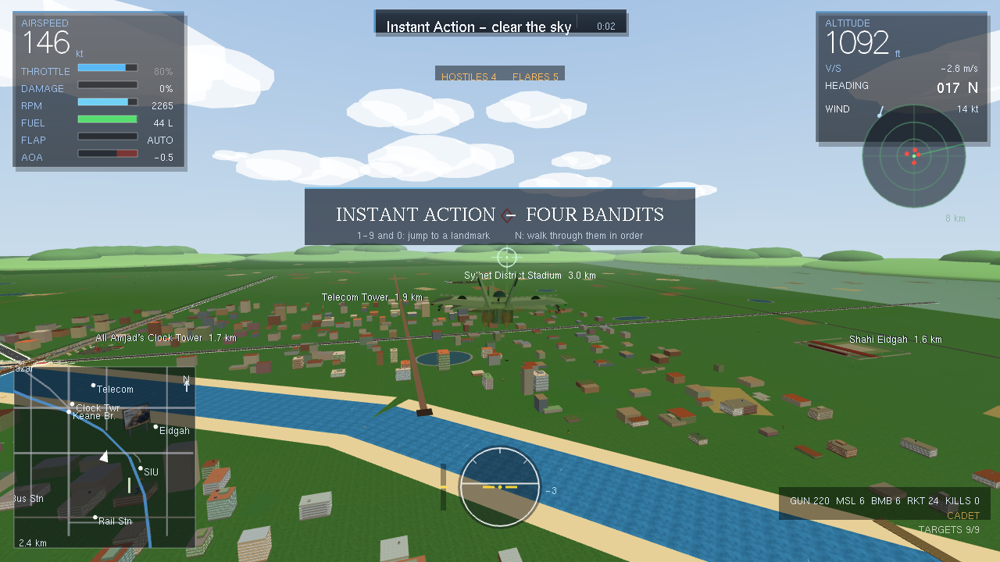
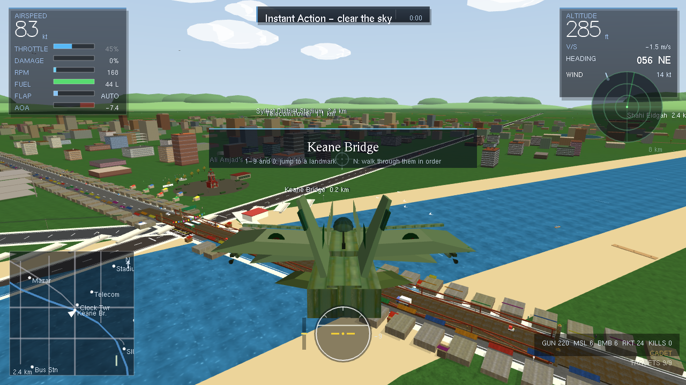

# Sylhet Attack

**A procedural combat flight simulator over Sylhet, Bangladesh — C++11, OpenGL and freeglut.**

[](https://isocpp.org/)
[](https://www.opengl.org/)
[](#build-and-run)
[](LICENSE)

Sylhet Attack is a complete, playable flight game rather than a rendering demo. You fly a
fictional Bangladesh Air Force light strike jet from the Sylhet International University
campus strip, over the Surma River and Keane Bridge, past Ali Amjad's Clock Tower and the
Shahjalal Mazar, and out to Osmani International Airport. The city, aircraft, HUD, effects
and sound are generated by code at start-up. There are no model, map or audio files to
download.

The project is a **CSE thesis project** by **Imran Khan (Roll 44008)**, supervised by
**Arnod Debnat** at Sylhet International University.



> **Fork it.** The source is MIT licensed. Build it, change the city, add a mission, or
> start a Godot/Unity port in a separate folder. See [Fork and contribute](#fork-and-contribute).

## Contents

- [What is in the game](#what-is-in-the-game)
- [Screenshots](#screenshots)
- [Build and run](#build-and-run)
- [Controls](#controls)
- [Missions](#missions)
- [Command line and evidence tools](#command-line-and-evidence-tools)
- [How the game is made](#how-the-game-is-made)
- [Fork and contribute](#fork-and-contribute)
- [Assets and licensing](#assets-and-licensing)
- [Credits](#credits)

## What is in the game

| Area | What you get |
| --- | --- |
| **World** | A compact 3.5 km Sylhet: 7 × 7 city chunks, about 1,300 procedural buildings, the Surma, Keane Bridge, tea gardens, ponds, villages, roads, railway, traffic, crowds, birds and six animated windsocks. |
| **Landmarks** | Ten recognisable, hand-built locations: Keane Bridge, Ali Amjad's Clock Tower, Hazrat Shahjalal Mazar, SIU, Osmani Airport, Sylhet Railway Station, District Stadium, Telecom Tower, Kadamtali Bus Terminal and Shahi Eidgah. |
| **Flight** | Custom arcade-realistic flight model: lift, drag, stall, ground effect, flaps, wind and gusts, afterburner, damage, landing grades and rearming at Osmani. Mouse + keyboard or gamepad. |
| **Combat** | Cannon with tracers and a lead pipper, homing missiles, bombs, rockets and flares. Enemy fighters with a patrol/engage/overshoot/evade state machine, bomber raids, AA flak and a nine-target ground war. |
| **Modes** | Defend the City, Deck Run, Strike and Return, BAF Training Range, Instant Action and a two-minute cinematic city demo. |
| **HUD** | Mission objective, airspeed/altitude/heading/throttle/fuel/health, radar, gunsight, target brackets, red bandit diamonds, kill feed, missile and pull-up warnings, briefing cards, medals, stars and a full debrief. |
| **Presentation** | Fixed-function OpenGL sky, fog, sun, clouds, textured ground and landmarks, large explosions, smoke, tracers and a cinematic demo camera. |
| **Audio** | A small software synthesiser built on `waveOut`: engine drone, wind, cannon, missiles, explosions, hits, lock warnings and menu feedback. No audio files. |
| **Tools** | Photo mode, self-capture screenshots, world statistics, a 10-shot smoke test, packaging and benchmark scripts. |

The game is intentionally **easy to win**. Bandits have 60 health (the ace 90), your cannon
does 20 a hit, enemy cannon fire does 1, and every bandit gets a red diamond so you can see
who to fight. The BAF Training Range has no hostiles at all.

## Screenshots

| Title screen | In flight over the city |
| --- | --- |
|  |  |

| Instant Action | Keane Bridge |
| --- | --- |
|  |  |

More images, including every landmark, are in [`screenshots/`](screenshots/).

## Build and run

### Requirements

- Windows 10 or 11 (64-bit).
- A MinGW `g++` compiler. The project is tested with the compiler shipped with
  **Code::Blocks** (`C:\Program Files\CodeBlocks\MinGW\bin\g++.exe`) and also works with
  Dev-C++'s MinGW64. A `g++` on `PATH` is picked up too.
- No external libraries to install. freeglut is vendored and statically linked.

### Build

```bat
git clone https://github.com/imrankhansaami/sylhet-attack.git
cd sylhet-attack

build.bat
```

`build.bat` prints `Build OK` and writes `SylhetAttack.exe` in the project folder. Run it
with:

```bat
run.bat
```

or double-click `SylhetAttack.exe`.

For compiler output in a console, use:

```bat
build.bat debug
```

If linking fails with **“Permission denied”**, an old `SylhetAttack.exe` is still running.
Close the game and build again.

### Optional photographic textures

The game is complete without textures and falls back to flat colours and procedural noise.
To add the CC0 Poly Haven texture set used in the screenshots:

```powershell
powershell -ExecutionPolicy Bypass -File tools\get_textures.ps1
```

The files land in `assets/textures/` and are loaded at start-up. They are optional and are
not required for a fork to build or run.

### Packaging

`tools\package.ps1` builds a self-contained run folder (and zip) under `dist\`. Build and
packaging output is deliberately not committed.

## Controls

The full controls are also available in-game: **H** while flying, or **Controls** on the
title screen.

| Input | Action |
| --- | --- |
| Mouse | Steer: mouse down = nose up, left/right = bank |
| Left click | Recentre the stick / click menus |
| Right click or **C** | Chase / cockpit camera |
| Mouse wheel or **W / S** | Throttle up / down |
| **A / D** | Rudder (also steers on the ground) |
| Arrow keys | Pitch and roll from the keyboard |
| **F** | Flaps: AUTO → 0% → 50% → 100% → AUTO |
| **I** | Invert pitch |
| **Space** | Wheel brakes |
| **E** | Start the engine |
| **R** | Restart the current mission |
| **M** | Radar zoom: 1.2 / 2.4 / 4.8 km |
| **L** | Landmark labels on / off |
| **P** | Photo mode |
| **Q** | Shadows on / off |
| **H** | Controls / help |
| **[** and **]** | Mouse sensitivity down / up; difficulty on the title screen |
| **,** and **.** | Cruise trim |
| **Z** (hold) | Cannon |
| **V** | Air-to-air missile |
| **B** | Bomb |
| **G** | Rockets (salvo of four) |
| **Tab** | Select the next bandit |
| **X** | Flare |
| **1–9, 0** | Jump to a landmark in flight |
| **N** | Next landmark |
| **F2** | Save a screenshot |
| **F3** | FPS overlay |
| **F11** | Fullscreen |
| **Esc** | Pause / back |

**Title screen:** `1`–`4` start the four missions, **D** starts the city demo, **[** / **]**
change difficulty (Easy, Normal, Ace), **F11** toggles fullscreen, **Esc** quits.

**Photo mode:** **W/A/S/D** move, **Q/E** down/up, mouse looks, **Z** changes time scale
(1× → 0.35× → 0.12× → frozen), **G** shows a rule-of-thirds grid, **H** hides the
viewfinder, **F2** saves the image.

A gamepad that Windows recognises is picked up automatically. Stick = pitch/roll; buttons
cover camera, brakes, flaps, engine, throttle and trim. No controller is required.

## Missions

| Mission | Objective | Win / fail |
| --- | --- | --- |
| **Defend the City** | Three bomber raids attack Keane Bridge, the Clock Tower and the Shahjalal Mazar. Intercept them, then land anywhere. | Stop all three raids. City integrity below 45% fails. |
| **Deck Run** | Thread three low gates over the Surma and Keane Bridge while AA fires from the banks. | Pass all three gates, then land. |
| **Strike and Return** | Destroy the convoy and the depot on the airport road, then land on runway 05. | Required ground targets destroyed and a safe landing; the landing grade is half the score. |
| **BAF Training Range** | The peaceful mission: engine start, taxi to the hold point, take off, fly the pattern, land. | No hostiles. Complete the steps and land. |
| **Instant Action** | One click into a dogfight over the river with four bandits. | A quick fight; no briefing. Return to the title when done. |
| **Watch the City Demo** | A two-minute cinematic fly-through of the city. | Press any key to return. |

Every sortie ends with a debrief: flight time, landing grade (from **BUTTER LANDING!** to
crash), damage, kills, gun accuracy, ground targets left, landmark damage, score, up to
three stars and a gold/silver/bronze medal.

There is no Free Flight or Patrol entry on the title screen. Instant Action is the quick
flight; the BAF Training Range is the teaching mission.

## Command line and evidence tools

The game accepts presentation, capture and benchmark flags. Use `--nobrief` when capturing
a flight frame, because the briefing card pauses the scene until a key is pressed.

| Flag | Purpose |
| --- | --- |
| `--defend`, `--deck`, `--strike`, `--training` | Start a named mission. |
| `--tour`, `--rings`, `--landing`, `--school`, `--free` | Legacy mission flags kept for old scripts. |
| `--instant` | Instant Action: airborne, four bandits, no briefing. |
| `--demo`, `--demotime <seconds>` | Cinematic demo; jump to a time. |
| `--landmark <0–9>` | Jump to a landmark; skips the briefing. |
| `--at <x> <z> <y>` | Place the aircraft at an exact position for a capture. |
| `--diff <0\|1\|2>` | Easy / Normal / Ace. |
| `--nobrief` | Skip the briefing card. |
| `--noenemy`, `--autofire` | Quiet capture or automatic cannon fire. |
| `--results` | Show a completed results screen. |
| `--shot <file.png>`, `--shotdelay <seconds>` | Capture the finished frame (PNG). |
| `--benchmark <file.csv>`, `--benchtimed <seconds>` | Measure frame rate at a viewpoint. |
| `--stats` | Print world counts without opening the game window. |
| `--size <w> <h>` | Set the window size. |
| `--help`, `--credits` | Open the controls or credits page. |

Examples:

```bat
REM A fresh city screenshot for a README or slide
SylhetAttack.exe --demo --demotime 17 --shot build\city.png --shotdelay 1

REM A clean in-flight frame without the briefing card
SylhetAttack.exe --defend --nobrief --at 0 0 450 --shot build\flight.png --shotdelay 4

REM World statistics
SylhetAttack.exe --stats
```

### Tests and packaging

| Tool | What it does |
| --- | --- |
| `tools\smoke_test.ps1` | Captures 10 scripted screens and checks they are not blank. |
| `tools\control_test.ps1` | Presses every control and saves a frame. |
| `tools\takeoff_test.ps1` | Repeats take-offs and reports pass/fail. |
| `tools\benchmark.ps1` | Runs the measured viewpoints and writes a CSV. |
| `tools\package.ps1` | Rebuilds `dist\SylhetAttack-run` with the exe, README and assets. |

The current smoke test passes **10 of 10** screens. These tools are useful evidence for a
report or viva, and they are the quickest way to confirm a fork did not break the game.

## How the game is made

### Code map

| File | Responsibility |
| --- | --- |
| `src/main.cpp` | freeglut window, callbacks and command-line flags. |
| `src/game.cpp` / `game.h` | Game states, input, cameras, particles, screenshot/benchmark plumbing and the frame loop. |
| `src/world.cpp` / `world.h` | Deterministic city generator, river, roads, airport, ten landmarks, collision data and static display lists. |
| `src/aircraft.cpp` / `aircraft.h` | Player jet model, flight model, damage, landing handling and cockpit overlay. |
| `src/missions.cpp` / `missions.h` | Mission definitions, raid director, ring course, objectives, scoring and stars. |
| `src/enemy.cpp` / `enemy.h` | Enemy AI, missiles, flares, wrecks, bomber raids and the ground war. |
| `src/hud.cpp` / `hud.h` | Title screen, HUD, radar, gunsight, labels, briefing, debrief, medals and credits. |
| `src/glutil.cpp` / `glutil.h` | Immediate-mode primitives, stroke text, 2D shapes and screen overlays. |
| `src/textures.cpp` / `textures.h` | Optional CC0 JPEG loading with a flat-colour fallback. |
| `src/sound.cpp` / `sound.h` | Procedural `waveOut` synthesis for the engine and one-shot effects. |
| `src/demo.cpp` / `demo.h` | Cinematic camera spline, captions and timing. |
| `src/traffic.cpp` / `traffic.h` | Road traffic, train, level crossings and moving vehicles. |
| `src/video.cpp` / `video.h` | Frame capture for the demo video. |
| `src/vecmath.h` | Small vector maths header. |
| `src/gl3/` | **Experimental** GL3/GLSL foundation. It is not compiled by `build.bat` and is not part of the shipping renderer. |

### Rendering, world and flight

- **Renderer:** fixed-function OpenGL 1.1, chosen deliberately for a small, static,
  no-DLL Windows build. Static geometry is compiled into display lists; moving objects use
  immediate mode. The sky is a vertex-coloured dome, the sun and clouds are billboards, and
  linear fog hides the edge of the generated world.
- **World:** a fixed random seed makes every launch identical. The 3.5 km city is split into
  7 × 7 chunks of 500 m for culling. The airport, runway 05, SIU grass strip, river, roads,
  railway and ten landmarks are anchored to real relative positions, then the generic city
  fills in around them.
- **Flight:** a custom force model rather than a rigid-body engine. Lift and drag come from
  airspeed and angle of attack; the wing stalls past about 15°; flaps add lift and drag;
  wind and gusts push the aircraft; the landing grade comes from sink rate and bank.
- **Combat:** the player has 220 cannon rounds (160 on Ace), six missiles, six bombs,
  24 rockets and 8/5/3 flares. Enemy fighters have 60 health (ace 90), and their cannon,
  missile and flak damage is deliberately low so the game stays winnable.
- **Audio:** the engine and every effect are synthesised into small buffers and streamed
  through `waveOut`. If no audio device exists, the game runs silently.

### Performance

The shipped build targets 1280 × 720. On the development machine (Intel UHD 620) it runs at
roughly 20–30 fps depending on the view; **Q** toggles the shadow pass, which is the largest
single cost. The renderer is CPU/draw-call bound, not GPU-bound. For a faster fork, the
obvious next steps are the instanced city and shader path sketched in `src/gl3/`, not more
post-processing on the fixed-function pipeline.

The `--stats` flag prints the generated world counts, and `--benchmark` writes a CSV you can
use in a report.

## Fork and contribute

**Anyone is welcome to fork this repository.** It is MIT licensed, has no private assets or
services, and builds with one batch file.

### Quick fork workflow

1. Click **Fork** on GitHub.
2. Clone your fork:

   ```bat
   git clone https://github.com/<your-name>/sylhet-attack.git
   cd sylhet-attack
   build.bat
   ```

3. Add the upstream remote so you can pull fixes:

   ```bat
   git remote add upstream https://github.com/imrankhansaami/sylhet-attack.git
   ```

4. Create a branch, make one focused change, build, and run the smoke test:

   ```bat
   git checkout -b fix/my-change
   build.bat
   powershell -ExecutionPolicy Bypass -File tools\smoke_test.ps1
   ```

5. Commit, push to your fork and open a pull request.

Read [`CONTRIBUTING.md`](CONTRIBUTING.md) for the full checklist.

### What makes a good contribution

- A bug fix with steps to reproduce and a before/after screenshot.
- A performance improvement with a benchmark table.
- A new landmark, mission or HUD improvement that fits the existing visual style.
- Documentation, build fixes or accessibility improvements.
- A Godot or Unity port in `ports/` — keep the C++ build working and the original game
  intact.

Please open an issue before a large feature so the scope can be agreed first. Keep the game
easy to win, keep the BAF Training Range peaceful, and do not add copyrighted models,
textures, music or fonts.

### Where to change things

| If you want to… | Start here |
| --- | --- |
| Add or change a mission | `src/missions.cpp` (`NAME`, `DESC`, `missionCreate`, `missionUpdate`, scoring). |
| Add a landmark | `src/world.cpp` (the `gLandmarks` table and its builder). |
| Tune the flight model | `src/aircraft.cpp` (mass, thrust, lift, stall, landing). |
| Tune weapons or enemy AI | `src/enemy.cpp` and `src/enemy.h`. |
| Change the HUD or menus | `src/hud.cpp` and `src/glutil.cpp`. |
| Add a sound | `src/sound.cpp` and `src/sound.h`. |
| Add a new source file | Add it to `build.bat`; otherwise it will not be compiled. |

## Assets and licensing

- **Original code and generated content:** MIT. See [`LICENSE`](LICENSE).
- **freeglut 3.8.0:** MIT/X11-style licence; see `third_party/freeglut/COPYING`.
- **stb_image, stb_image_write, stb_perlin:** public domain / MIT; see `third_party/stb`.
- **GLAD:** generated loader; its header carries the SPDX licence notice.
- **Photographic textures:** CC0 from [Poly Haven](https://polyhaven.com), optional. The
  file list and sources are in `assets/textures/_sources.txt`; `tools/get_textures.ps1`
  downloads them. Credit is given as a matter of academic practice.
- **Billboard artwork:** produced for this project. The names on the boards are part of the
  presentation; replace them with your own artwork when forking if you prefer.
- **Screenshots:** included as project documentation.

Full third-party notices are in [`LICENSES.txt`](LICENSES.txt).

> **Disclaimer:** Sylhet Attack is a fictional training scenario. It is not affiliated with
> or endorsed by the Bangladesh Air Force. Sylhet is represented at a compressed scale for
> gameplay; the landmarks are artistic interpretations, not survey-accurate models. No
> civilians are targeted in the game.

## Credits

**Sylhet Attack** — C++ / OpenGL thesis project, 2026.

- **Imran Khan** — Roll 44008
- **Supervisor:** Arnod Debnat
- Department of Computer Science and Engineering, Sylhet International University

Built with C++11, freeglut, OpenGL, MinGW and the Code::Blocks toolchain. Textures are from
Poly Haven under CC0. Every other model, texture, sound and line of game code was generated
or written for this project.

> *Every flight starts and ends at a real place in Sylhet.*

---

If this project is useful to you, a star helps other people find it. Forks, issues and pull
requests are welcome.